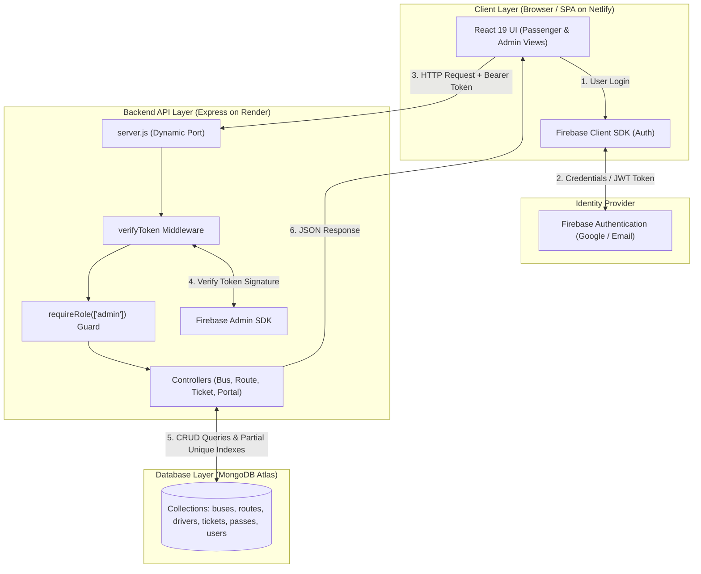

# 🚍 E-Bus Management System

A full-stack, enterprise-grade transit management web application designed for regional transit operators, educational institutions, and daily commuters. The system centralizes fleet operations, multi-stop transit routes, commercial driver allocations, student transit passes, passenger seat bookings, and revenue tracking into a single, responsive portal.

[](https://ebus-management-system.netlify.app/)
[](https://ebus-management-system.onrender.com)
[](https://ebus-management-system.onrender.com/health)
[](backend/test/audit_and_rbac.test.js)

---

## 📖 Table of Contents

1. [Overview & Problem Solved](#-overview--problem-solved)
2. [User Personas & Role Matrix](#-user-personas--role-matrix)
3. [Key Features & Highlights](#-key-features--highlights)
4. [Role-Tabbed Login & Presentation Mode](#-role-tabbed-login--presentation-mode)
5. [Technology Stack](#-technology-stack)
6. [System Architecture](#-system-architecture)
7. [Repository Structure](#-repository-structure)
8. [Step-by-Step Local Setup Guide](#-step-by-step-local-setup-guide)
9. [Preloading Demo Data (One-Click Seeder)](#-preloading-demo-data-one-click-seeder)
10. [REST API Endpoint Reference](#-rest-api-endpoint-reference)
11. [Security Hardening & Data Integrity](#-security-hardening--data-integrity)
12. [Testing & Quality Verification](#-testing--quality-verification)
13. [License](#-license)

---

## 🎯 Overview & Problem Solved

Managing bus transit networks often relies on disjointed tools: paper logbooks for drivers, spreadsheets for bus maintenance, disparate physical slips for passenger ticketing, and separate offices for student bus passes.

The **E-Bus Management System** unifies these operations into an authenticated, real-time portal:
* **For Operators:** Eliminates data silos by linking buses, routes, intermediate stops, drivers, and revenue in one dashboard.
* **For Passengers:** Provides an airline-style booking flow with interactive seat selection, instant QR boarding passes, and flexible cancellation.
* **For Institutions:** Streamlines student transit enrollment and digital bus pass management.

---

## 👥 User Personas & Role Matrix

The platform is designed around two distinct user categories protected by server-side Role-Based Access Control (RBAC):

| Dimension | 🛡️ Transport Administrator | 👤 Passenger / Student Commuter |
|---|---|---|
| **Target User** | Transit Authority, Depot Manager, Fleet Operator | Daily commuter, college student, general public |
| **Primary Goal** | Fleet logistics, route planning, revenue oversight | Transit search, seat reservation, pass applications |
| **Core Capabilities** | • Create & edit buses, capacities, and base fares<br>• Define routes with intermediate pickup stops<br>• Assign commercial drivers with verified licenses<br>• Approve and manage student transit passes<br>• Review system-wide revenue & audit activity logs | • Search buses by origin, destination & date<br>• View intermediate route stops & travel times<br>• Select seats visually via live seating layout<br>• Download/Print digital boarding pass with QR code<br>• Apply for subsidized student bus passes<br>• Cancel active bookings with instant seat release |
| **Authorization** | Restricted to server-verified `ADMIN_EMAILS` | Assigned to all registered public users by default |
| **Landing View** | `/dashboard` (Executive Fleet Analytics) | `/passenger/book` (Service Search & Booking) |

---

## ✨ Key Features & Highlights

### 1. 🎫 Interactive Seat Booking & Instant Boarding Pass
* **Visual Seating Grid:** Generates dynamic bus seat layouts based on vehicle capacity. Booked seats are locked in real-time.
* **Double-Booking Prevention:** Backed by a MongoDB partial unique compound index (`{ busNumber, journeyDate, seatNumber }` where `status: "Booked"`), guaranteeing that concurrent booking attempts never assign the same seat.
* **Official Boarding Pass:** Generates a printable digital pass with journey details, seat badge, perforated tear-off line, and a **scannable QR verification code**. Supports one-click **Save as PDF / Print**.

### 2. 🛣️ Multi-Stop Route Linking
* **Intermediate Stop Matching:** Searching from intermediate stops (e.g., *Mangaldai* to *Guwahati*) automatically matches parent routes (*Kharupetia - Guwahati Express*).
* **Dropdown Route Integrity:** Bus creation enforces selecting valid, active routes from a dropdown, preventing orphaned buses caused by manual typing errors.

### 3. 🚌 Fleet & Driver Coordination
* **Two-Stage Bus Deletion Protection:** Active buses cannot be deleted directly; operators must first transition them to `Maintenance`. Buses with active passenger tickets are protected against accidental deletion.
* **Driver Records:** Tracks driver profiles, contact numbers, years of experience, and commercial license numbers linked directly to fleet vehicles.

### 4. 🎓 Student Commuter Passes
* Issues digital transit passes with Monthly, Quarterly, or Yearly validity.
* Displays validity countdowns and active/expired status badges.

### 5. 💳 Internal Accounting & Payment Tracking
* Records fare transactions with simulated transaction IDs and payment channels (UPI, Card, Net Banking, Cash).
* Ticket cancellations automatically release seat reservations and mark internal accounting records as `Refunded`.

---

## 🔑 Role-Tabbed Login & Presentation Mode

To make demonstrations, viva presentations, and recruiter evaluations effortless, the authentication screen ([`src/pages/Login.jsx`](src/pages/Login.jsx)) includes a **Role Selector** and a **One-Click Presentation Mode**:

```
┌────────────────────────────────────────────────────────┐
│               🚍 E-Bus Transit Portal                  │
│                                                        │
│     ┌───────────────────────┬───────────────────────┐  │
│     │ 👤 Passenger / Student│  🛡️ Transport Admin   │  │
│     └───────────────────────┴───────────────────────┘  │
│                                                        │
│   Email:    [ passenger.demo@ebus.com              ]   │
│   Password: [ ••••••••••••                         ]   │
│                                                        │
│   [                 Sign In                        ]   │
│                                                        │
│   ── Presentation Mode ──────────────────────────────  │
│   [ ⚡ Autofill Demo Passenger / Admin Account ]        │
└────────────────────────────────────────────────────────┘
```

### Why This Is Included:
* **Zero Fumbling in Demos:** Evaluators or interviewers do not need to register a new account or memorize passwords—clicking **"Autofill Demo Account"** populates test credentials with one click.
* **True Role Separation:** Switching between the Passenger and Admin tabs illustrates the two sides of the system without requiring separate login URLs.
* **Server-Enforced Security:** Client tab selection is purely presentation; the backend middleware cryptographically verifies user claims before granting administrative access.

---

## 🛠️ Technology Stack

| Layer | Technology | Version | Purpose in Application |
|---|---|---|---|
| **Frontend UI** | **React.js** | `^19.2.7` | Component-driven user interface with responsive dark/light theme switching. |
| **Build Tool** | **Vite** | `^8.1.1` | Ultra-fast HMR development server and optimized production bundler. |
| **Routing** | **React Router DOM** | `^7.18.1` | Single-Page-Application client-side routing with role-based protected guards. |
| **Client Auth** | **Firebase SDK** | `^12.16.0` | Client-side user authentication, session persistence, and ID token (JWT) management. |
| **Backend API** | **Express.js** | `^5.2.1` | RESTful API server handling transit routing, booking transactions, and RBAC. |
| **Runtime** | **Node.js** | `v20+` | Asynchronous event-driven server runtime environment. |
| **Server Auth** | **Firebase Admin SDK** | `^13.10.0` | Cryptographic signature validation of incoming Bearer tokens on protected routes. |
| **Database** | **MongoDB Atlas** | `v7.0+` | Cloud-hosted NoSQL document database storing transit collections. |
| **Data Modeling** | **Mongoose** | `^9.9.3` | Strict object data modeling, schema validations, and compound indexing. |
| **Styling** | **Custom CSS3** | — | Theme-aware custom properties (`--bg-app`, `--primary`), zero heavy CSS framework bloat. |

---

## 🏗️ System Architecture



---

## 📁 Repository Structure

The project uses the standard **SPA Root with Embedded Backend** architecture: the frontend lives at the repository root for zero-config deployment on Netlify, while the backend API is isolated in `/backend`.

```text
ebus-project/
├── index.html                    # SPA HTML entry point
├── package.json                  # Frontend dependencies (React 19, Vite, Firebase)
├── vite.config.js                # Vite build configuration
├── netlify.toml / vercel.json    # Production SPA routing rewrite rules
│
├── public/                       # Static public assets (icons, favicons)
│
├── src/                          # FRONTEND APPLICATION SOURCE
│   ├── App.jsx                   # Client route declarations & guards
│   ├── main.jsx                  # React DOM mount point
│   ├── firebase.js               # Firebase Client SDK initialization
│   ├── styles.css                # Global design system & theme variables
│   │
│   ├── components/               # Reusable UI Components
│   │   ├── Navbar.jsx            # Admin top navigation bar
│   │   ├── PassengerNavbar.jsx   # Passenger portal navigation bar
│   │   ├── Sidebar.jsx           # Collapsible hover-to-expand admin navigation
│   │   ├── StatCard.jsx          # Metric statistic cards
│   │   ├── RecentActivity.jsx    # Live audit activity timeline
│   │   └── TicketModal.jsx       # 🎫 Printable Boarding Pass & QR Modal
│   │
│   ├── context/                  # React Context Providers
│   │   ├── AuthContext.jsx       # User identity & server role provider
│   │   └── ThemeContext.jsx      # Dark / Light theme persistence
│   │
│   ├── pages/                    # Views & Feature Pages
│   │   ├── Login.jsx             # 🔑 Role-tabbed login with quick-fill demo
│   │   ├── Register.jsx          # Account registration
│   │   ├── Dashboard.jsx         # Executive dashboard + One-click seeder banner
│   │   ├── BusManagement.jsx     # Fleet CRUD with route dropdown selector
│   │   ├── RouteManagement.jsx   # Route & intermediate stop builder
│   │   ├── DriverManagement.jsx  # Driver profiles & bus assignments
│   │   ├── StudentManagement.jsx # Student commuter registry
│   │   ├── PassManagement.jsx    # Student transit pass management
│   │   ├── PaymentManagement.jsx # Fare transaction records
│   │   └── passenger/            # PASSENGER PORTAL MODULES
│   │       ├── BookTicket.jsx    # Multi-stop search, seat grid & booking
│   │       ├── MyBookings.jsx    # Booking history & boarding pass download
│   │       └── MyPasses.jsx      # Pass application & active pass wallet
│   │
│   └── styles/                   # Scoped Component Stylesheets
│       ├── auth.css              # Theme-aware login/register cards
│       ├── dashboard.css         # Dashboard grid & presentation banner
│       └── passenger.css         # Seating grid & print boarding pass styles
│
└── backend/                      # BACKEND API APPLICATION (Node.js + Express)
    ├── server.js                 # Express server & MongoDB connection
    ├── package.json              # Backend dependencies (Express 5, Mongoose 9)
    ├── config/                   # Firebase Admin SDK configuration
    ├── middleware/               # Token verification & RBAC authorization
    ├── models/                   # Mongoose Schemas (Bus, Route, Ticket, Driver, Pass)
    ├── controllers/              # REST Controller business logic
    ├── routes/                   # Express API Route handlers
    ├── utils/demoData.js         # 🚍 Realistic Assam transit dataset
    ├── scripts/seed_demo_data.js # Standalone database seeder script
    └── test/                     # Automated test suites (audit & RBAC tests)
```

---

## 🚀 Step-by-Step Local Setup Guide

Follow these simple steps to run the complete system locally.

### Step 1: Clone the Repository
```bash
git clone https://github.com/anideva/ebus-management-system.git
cd ebus-management-system/ebus-project
```

### Step 2: Install Dependencies
Install dependencies for both the frontend and backend:
```bash
# 1. Install frontend dependencies (from root)
npm install

# 2. Install backend dependencies
cd backend
npm install
cd ..
```

### Step 3: Configure Environment Variables

#### Backend Configuration (`backend/.env`):
Create a file named `.env` inside the `backend/` folder:
```env
PORT=5000
MONGO_URI=your_mongodb_atlas_connection_string

# Whitelist your email for administrative access (comma-separated)
ADMIN_EMAILS=admin@ebus.com,your-email@example.com

# Firebase Admin credentials: paste your service account JSON string or path
FIREBASE_SERVICE_ACCOUNT={"type":"service_account","project_id":"..."}
```

> [!TIP]
> Ensure your current IP address is whitelisted in **MongoDB Atlas &rarr; Network Access &rarr; Allow Access from Anywhere (`0.0.0.0/0`)** so your local backend can connect.

#### Frontend Configuration (`.env`):
Create a file named `.env` at the root of `ebus-project/`:
```env
# Points to local Express server during development
VITE_API_URL=http://localhost:5000
```

### Step 4: Run the Application

Start the backend and frontend in two separate terminal windows:

```bash
# Terminal 1: Start Backend (Port 5000)
cd backend
npm start
```

```bash
# Terminal 2: Start Frontend (Port 5173)
npm run dev
```

Visit **`http://localhost:5173`** in your browser.

---

## 🚍 Preloading Demo Data (One-Click Seeder)

To showcase the system with realistic data without manual data entry, the project includes an automated transit dataset representing the **Assam Regional Transit Corridor**:

| Route Corridor | Endpoints | Intermediate Pickup Stops | Fleet Vehicles Assigned |
|---|---|---|---|
| **Kharupetia - Guwahati Express** | Kharupetia ➔ Guwahati | Mangaldai, Sipajhar, Baihata Chariali, Jalukbari | • `AS-01-KB-1001` (AC Deluxe)<br>• `AS-01-KB-1002` (Standard Express) |
| **Guwahati - Kharupetia Return** | Guwahati ➔ Kharupetia | Jalukbari, Baihata Chariali, Sipajhar, Mangaldai | • `AS-01-GK-2001` (AC Deluxe) |
| **Tezpur - Guwahati Deluxe** | Tezpur ➔ Guwahati | Kaliabor, Nagaon Bypass, Jagiroad, Khanapara | • `AS-12-TG-3001` (Volvo Multi-Axle) |
| **Guwahati - Tezpur Deluxe** | Guwahati ➔ Tezpur | Khanapara, Jagiroad, Nagaon Bypass, Kaliabor | • `AS-12-GT-3002` (AC Sleeper) |
| **Silchar - Guwahati Superfast** | Silchar ➔ Guwahati | Badarpur, Haflong, Lumding, Dispur | • `AS-11-SG-4001` (Super Luxury) |

### How to Seed:
* **Option A (From UI):** Log in as Admin &rarr; Navigate to `/dashboard` &rarr; Click **`⚡ Load Demo Fleet & Routes`**.
* **Option B (From Terminal):** Run `npm run seed` from the project root.

---

## 📡 REST API Endpoint Reference

All endpoints (except `/health` and root) require an `Authorization: Bearer <token>` header.

### 1. Public & Diagnostics
| Method | Endpoint | Description | Role Required |
|---|---|---|---|
| `GET` | `/health` | Backend status & MongoDB connectivity check | Public |
| `GET` | `/api/auth/me` | Returns authenticated user profile and assigned role | Authenticated |

### 2. Passenger Portal (`/api/portal`)
| Method | Endpoint | Description | Role Required |
|---|---|---|---|
| `GET` | `/api/portal/services` | Query available buses by origin, destination & intermediate stops | Authenticated |
| `GET` | `/api/portal/buses/:busNumber/seats` | Get live seat booking layout for a specific bus & journey date | Authenticated |
| `POST` | `/api/portal/book-ticket` | Book an available seat with double-booking index protection | Authenticated |
| `GET` | `/api/portal/my-tickets` | Retrieve all tickets booked by the authenticated passenger | Authenticated |
| `PUT` | `/api/portal/cancel-ticket/:ticketId` | Cancel a booking, release seat, and mark refund internally | Authenticated (Owner/Admin) |
| `GET` | `/api/portal/my-passes` | Retrieve student passes owned by the authenticated student | Authenticated |
| `POST` | `/api/portal/apply-pass` | Apply for a new subsidized student transit pass | Authenticated |

### 3. Transport Administration (Admin Protected)
| Method | Endpoint | Description | Role Required |
|---|---|---|---|
| `GET / POST` | `/api/buses` | Retrieve all fleet buses / Add bus with route selection | `admin` |
| `PUT / DELETE`| `/api/buses/:id` | Update bus details / Two-stage protected deletion | `admin` |
| `GET / POST` | `/api/routes` | Retrieve transit corridors / Create route with stops | `admin` |
| `PUT / DELETE`| `/api/routes/:id` | Update route details / Delete route | `admin` |
| `GET / POST` | `/api/drivers` | Retrieve drivers / Register driver with license | `admin` |
| `GET / POST` | `/api/students` | Retrieve students / Register student commuter | `admin` |
| `GET / POST` | `/api/passes` | Manage and approve student transit passes | `admin` |
| `GET / POST` | `/api/payments` | Audit fare transactions / Record manual payment | `admin` |
| `GET` | `/api/dashboard/recent-activity` | Retrieve latest 10 cross-module audit logs | `admin` |
| `POST` | `/api/dashboard/seed-demo` | Trigger transit fleet seeder service | `admin` |

---

## 🛡️ Security Hardening & Data Integrity

1. **Role-Based Access Control (RBAC):** All administrative endpoints enforce `requireRole(['admin'])`. New registrations default strictly to `passenger`; admin privileges require matching the server's `ADMIN_EMAILS` environment variable.
2. **IDOR Elimination on Tickets:** Cancellation and ticket queries enforce that non-admin passengers can only view or cancel tickets where `userEmail` or `userId` matches their verified token identity.
3. **Double-Booking Prevention:** Enforced at the database engine level via MongoDB compound partial unique index:
   ```javascript
   ticketSchema.index(
     { busNumber: 1, journeyDate: 1, seatNumber: 1 },
     { unique: true, partialFilterExpression: { status: "Booked" } }
   );
   ```
4. **Server-Enforced Fares:** Passenger booking payloads cannot tamper with ticket amounts. The server retrieves the canonical fare from the referenced bus record in MongoDB before ticket creation.
5. **CORS Isolation:** Cross-Origin Resource Sharing is restricted to authorized production domains (`ebus-management-system.netlify.app`) and local development ports.

---

## 🧪 Testing & Quality Verification

The repository includes a comprehensive Node.js test suite with zero external mock frameworks:

```bash
# Run backend test suite (from backend/ directory)
npm test
```

### Test Suite Coverage:
* **Suite 1:** Default Role Assignment on Public Registration (`passenger`)
* **Suite 2:** Whitelisted Administrator Promotion via `ADMIN_EMAILS`
* **Suite 3:** Hardened Ticket Ownership Checks & IDOR Protection
* **Suite 4:** Server-Side Bus Fare Enforcement (Tamper Protection)
* **Suite 5:** Booking Concurrency & Partial Unique Index Seat Rebooking
* **Suite 6:** Cancellation Accounting Reality & Status Verification
* **Suite 7:** Passenger Booking Input Validations & Bus Capacity Bounds
* **Suite 8:** RBAC Permission Verification Across All 8 Admin Routers
* **Suite 9:** Two-Stage Bus Deletion Protection & Referential Integrity
* **Suite 10:** Admin Ticket Creation Bus Status Validation
* **Suite 11:** Bus-Route Linking Contract & Multi-Stop Search Service

### Quality Checks:
```bash
# Run frontend ESLint check
npm run lint

# Run frontend production build
npm run build
```

---

## 📄 License

This project is licensed under the **ISC License**. Developed as an enterprise-grade transit demonstration and portfolio project.