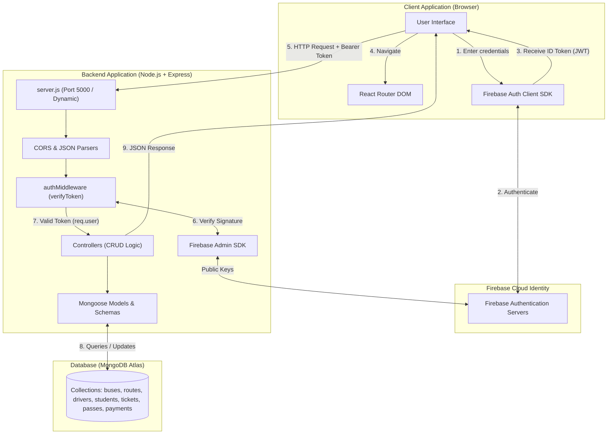

# 🚍 E-Bus Management System

A full-stack web application designed for transit operators, educational institutions, and fleet managers to coordinate fleet operations, bus routes, driver schedules, student transit allocations, ticket bookings, student passes, and fare payments from a single unified interface.

---

## 📖 Table of Contents

1. [Overview & Problem Solved](#-overview--problem-solved)
2. [Key Features & Modules](#-key-features--modules)
3. [Technology Stack](#-technology-stack)
4. [System Architecture](#-system-architecture)
5. [Request & Authentication Flow](#-request--authentication-flow)
6. [Repository Structure](#-repository-structure)
7. [Prerequisites](#-prerequisites)
8. [Step-by-Step Installation & Setup](#-step-by-step-installation--setup)
9. [Environment Variable Configuration](#-environment-variable-configuration)
10. [Running the Application Locally](#-running-the-application-locally)
11. [REST API Endpoint Reference](#-rest-api-endpoint-reference)
12. [Database Models & Schema](#-database-models--schema)
13. [Authentication & Security Practices](#-authentication--security-practices)
14. [Testing & Quality Verification](#-testing--quality-verification)
15. [Troubleshooting & FAQs](#-troubleshooting--faqs)
16. [Current Limitations & Roadmap](#-current-limitations--roadmap)
17. [Contributing](#-contributing)
18. [License](#-license)

---

## 🎯 Overview & Problem Solved

Managing bus transit networks often involves fragmented records: paper logbooks for drivers, spreadsheets for bus maintenance, disparate booking slips for passengers, and separate systems for student passes. 

The **E-Bus Management System** solves this by centralizing transit logistics into an authenticated, real-time management portal. Administrators can:
* Prevent double-booking with real-time seat availability checks.
* Link routes, drivers, and buses without duplicating manual records.
* Manage student bus passes and transit assignments.
* Track payment statuses and revenue totals dynamically.
* Monitor operational events in a real-time activity feed.

---

## ✨ Key Features & Modules

### 1. 📊 Centralized Dashboard
* Aggregate KPI cards: Total Buses, Active Routes, Registered Students, Active Passes, Total Revenue (calculated from paid transactions), and Total Tickets.
* Live Recent Activity timeline auditing the latest actions across all system modules.

### 2. 🚌 Bus Management
* Add, edit, view, and delete fleet vehicles.
* Configure vehicle number, name, seating capacity, fare rate, assigned driver, assigned route, and operational status (`Active` / `Maintenance`).
* Client-side duplicate vehicle number prevention.

### 3. 🛣️ Route Management
* Define transit paths with source, destination, intermediate stops, total distance (km), and estimated travel time (mins).
* Manage status (`Active` / `Inactive`) and prevent duplicate route identifiers.

### 4. 👨‍✈️ Driver Management
* Manage driver profiles: Driver ID, full name, phone number, years of experience, unique commercial license number, assigned bus, and duty status (`Active` / `On Leave`).

### 5. 🎓 Student Management
* Register students with student ID, name, grade/class, section, emergency contact number, assigned route, and bus.
* Manage enrollment status (`Active` / `Inactive`).

### 6. 🎟️ Ticket Booking & Seat Management
* Issue bus tickets with passenger name, travel date, route, fare, and individual seat selection.
* Dynamic seating grid generated from the assigned bus capacity.
* Automated seat availability validation: already-booked seats are disabled and labeled for that specific bus and travel date.

### 7. 🎫 Pass Management
* Issue student transit passes: Monthly, Quarterly, or Yearly validity.
* Track validity start and expiration dates with active status management.

### 8. 💳 Payment Management
* Record passenger fare payments with transaction ID and payment methods (UPI, Debit Card, Credit Card, Net Banking, Cash).
* Automated pre-fill: selecting a booked ticket automatically populates the passenger name and fare amount.
* Track payment status (`Paid`, `Pending`, `Failed`, `Refunded`).

---

## 🛠️ Technology Stack

| Layer | Technology | Role & Purpose |
|---|---|---|
| **Frontend Framework** | **React.js (v19)** | Declarative component-based UI library that efficiently renders the user interface and updates state changes. |
| **Build Tool** | **Vite (v8)** | High-speed frontend build tool providing Instant Server Start, Hot Module Replacement (HMR), and optimized production bundling. |
| **Client Routing** | **React Router DOM (v7)** | Single Page Application (SPA) declarative client-side routing and protected route navigation. |
| **Authentication (Client)** | **Firebase Authentication** | Manages user sign-up, sign-in, session persistence, and securely generates JSON Web Tokens (JWT ID Tokens). |
| **Backend Runtime** | **Node.js (v20+)** | High-performance asynchronous JavaScript server runtime. |
| **Backend Framework** | **Express.js (v5)** | Minimalist web framework for routing, middleware handling, and RESTful API endpoint definition. |
| **Authentication (Server)** | **Firebase Admin SDK** | Cryptographically validates incoming Firebase Bearer ID tokens on every protected API endpoint. |
| **Database** | **MongoDB Atlas** | Distributed NoSQL document database storing application data in structured collections. |
| **Object Data Modeling (ODM)** | **Mongoose (v9)** | Schema-based data modeling layer providing strict types, validations, default values, and query abstraction. |
| **CORS Middleware** | **cors** | Configures Cross-Origin Resource Sharing headers to permit authorized frontend-backend communication. |
| **Environment Config** | **dotenv** | Loads environment variables from `.env` files into `process.env`. |

---

## 🏗️ System Architecture



---

## 🔐 Request & Authentication Flow

1. **User Sign In:** The user registers or signs in using their email and password through the React login form.
2. **Token Generation:** Firebase Client SDK authenticates the user and returns a signed Firebase ID Token (JWT).
3. **API Invocation:** When making API requests (e.g. creating a bus, booking a ticket), the frontend retrieves the token using `await user.getIdToken()` and attaches it to the HTTP request:
   ```http
   Authorization: Bearer <firebase-id-token>
   ```
4. **Token Verification:** The backend Express middleware ([`backend/middleware/authMiddleware.js`](backend/middleware/authMiddleware.js)) intercepts the request, extracts the Bearer token, and verifies it with the Firebase Admin SDK using `admin.auth().verifyIdToken(token)`.
5. **Controller Execution:** If the token is valid, the decoded user payload is assigned to `req.user` and the request proceeds to the respective controller to query MongoDB. If invalid or missing, a `401 Unauthorized` response is returned immediately.

---

## 📁 Repository Structure

```
ebus-project/
├── .env.example                  # Template for frontend environment variables
├── .gitignore                    # Git exclusion rules (protects credentials & node_modules)
├── eslint.config.js              # ESLint configuration
├── index.html                    # Single Page Application entrypoint
├── netlify.toml                  # Netlify SPA redirect rules
├── package.json                  # Frontend dependencies and scripts
├── package-lock.json
├── README.md                     # Project documentation
├── vercel.json                   # Vercel SPA rewrite rules
├── vite.config.js                # Vite build configuration
│
├── public/                       # Static public assets
│   └── vite.svg
│
├── src/                          # React Frontend Source
│   ├── App.jsx                   # Route declarations
│   ├── firebase.js               # Client Firebase SDK initialization
│   ├── main.jsx                  # React DOM mount point
│   ├── styles.css                # Base CSS
│   │
│   ├── config/
│   │   └── api.js                # Central API Base URL provider (VITE_API_URL)
│   │
│   ├── components/               # Reusable UI Components
│   │   ├── Navbar.jsx            # Top navbar with user email & logout
│   │   ├── RecentActivity.jsx    # Real-time activity timeline
│   │   ├── Sidebar.jsx           # Application navigation sidebar
│   │   ├── StatCard.jsx          # Metric cards
│   │   └── WelcomeSection.jsx    # Dashboard greeting
│   │
│   ├── pages/                    # Views / Modules
│   │   ├── BusManagement.jsx     # Bus fleet operations
│   │   ├── Dashboard.jsx         # Executive dashboard & metrics
│   │   ├── DriverManagement.jsx  # Driver profiles & assignments
│   │   ├── Login.jsx             # User login
│   │   ├── PassManagement.jsx    # Student transit passes
│   │   ├── PaymentManagement.jsx # Fare transaction tracking
│   │   ├── Register.jsx          # New user registration
│   │   ├── RouteManagement.jsx   # Route & stop management
│   │   ├── StudentManagement.jsx # Student transit enrollment
│   │   └── TicketManagement.jsx  # Ticketing & seat selection
│   │
│   └── styles/                   # Modular CSS stylesheets
│       ├── auth.css
│       ├── busManagement.css
│       ├── dashboard.css
│       ├── navbar.css
│       ├── recentActivity.css
│       ├── sidebar.css
│       ├── statcard.css
│       └── welcome.css
│
└── backend/                      # Node.js + Express API
    ├── .env.example              # Template for backend environment variables
    ├── package.json              # Backend dependencies and scripts
    ├── package-lock.json
    ├── server.js                 # Express server & MongoDB connection
    │
    ├── config/
    │   └── firebaseAdmin.js      # Firebase Admin SDK initialization
    │
    ├── middleware/
    │   └── authMiddleware.js     # verifyToken middleware
    │
    ├── models/                   # Mongoose Schemas & Models
    │   ├── bus.js
    │   ├── driver.js
    │   ├── pass.js
    │   ├── payment.js
    │   ├── route.js
    │   ├── student.js
    │   └── ticket.js
    │
    ├── controllers/              # Controller business logic
    │   ├── busController.js
    │   ├── dashboardController.js
    │   ├── driverController.js
    │   ├── passController.js
    │   ├── paymentController.js
    │   ├── routeController.js
    │   ├── studentController.js
    │   └── ticketController.js
    │
    └── routes/                   # API Express Routers
        ├── busRoutes.js
        ├── dashboardRoutes.js
        ├── driverRoutes.js
        ├── passRoutes.js
        ├── paymentRoutes.js
        ├── routeRoutes.js
        ├── studentRoutes.js
        └── ticketRoutes.js
```

---

## 📋 Prerequisites

Before installing the application, ensure the following are installed on your machine:
* **Node.js**: v18.0.0 or higher (v20+ recommended). Check with `node -v`.
* **npm**: v9.0.0 or higher. Check with `npm -v`.
* **Git**: Installed and configured. Check with `git --version`.
* **MongoDB**: A free MongoDB Atlas cluster or a local MongoDB database instance.
* **Firebase Account**: Access to [Firebase Console](https://console.firebase.google.com/) for authentication and a service account key.

---

## 🚀 Step-by-Step Installation & Setup

### Step 1: Clone the Repository
```bash
git clone https://github.com/<your-username>/<your-repo-name>.git
cd ebus-project
```

### Step 2: Install Frontend Dependencies
From the repository root (`ebus-project`):
```bash
npm install
```

### Step 3: Install Backend Dependencies
Navigate into the `backend` directory and install dependencies:
```bash
cd backend
npm install
cd ..
```

---

## ⚙️ Environment Variable Configuration

The project uses separate environment configurations for the backend and the frontend. Template files (`.env.example`) are provided in both directories.

> [!CAUTION]
> Never commit actual `.env` files, passwords, or Firebase private keys to version control. The `.gitignore` file is pre-configured to ignore all `.env` and service-account files.

### 1. Backend Environment Setup (`backend/.env`)
Create a new file named `.env` inside the `backend/` directory:
```bash
# In backend/.env
PORT=5000
MONGO_URI=mongodb+srv://<username>:<password>@<cluster-url>/ebus-management?retryWrites=true&w=majority

# Firebase Admin Service Account:
# Option 1 (Recommended for production/Render): Paste entire JSON content as a single line
FIREBASE_SERVICE_ACCOUNT={"type":"service_account","project_id":"your-project-id",...}

# Option 2 (Local file): Place your downloaded service-account JSON in backend/firebase-service-account.json
```

#### How to obtain your Firebase Admin Service Account key:
1. Open the [Firebase Console](https://console.firebase.google.com/).
2. Select your project &rarr; **Project Settings** (gear icon) &rarr; **Service accounts**.
3. Click **Generate new private key** and download the `.json` file.
4. Either place the file in `backend/firebase-service-account.json` or paste its contents into `FIREBASE_SERVICE_ACCOUNT` in `backend/.env`.

### 2. Frontend Environment Setup (`.env`)
Create a new file named `.env` at the root of `ebus-project/`:
```bash
# In .env (root)
# Points to local Express server during development
VITE_API_URL=http://localhost:5000
```
*(In production, set `VITE_API_URL` to your deployed backend URL, such as `https://your-api.onrender.com`)*.

---

## 💻 Running the Application Locally

The frontend and backend run as independent processes. Start them in two separate terminal windows.

### Terminal 1: Start the Backend Server
```bash
cd backend
npm start
```
* The backend server will start at: `http://localhost:5000`
* You should see:
  ```
  Firebase Admin initialized successfully
  Server running on port 5000
  MongoDB connected successfully
  ```

### Terminal 2: Start the Frontend Application
```bash
# At the root (ebus-project)
npm run dev
```
* The Vite dev server will start at: `http://localhost:5173`
* Open your browser and navigate to `http://localhost:5173`.

---

## 📡 REST API Endpoint Reference

All API routes require authentication using a valid Firebase ID token in the `Authorization: Bearer <token>` header, except for the public health checks.

### Public Endpoints
| Method | Endpoint | Description | Auth Required |
|---|---|---|---|
| `GET` | `/` | API status message | No |
| `GET` | `/health` | Server health and database connection status | No |

### Bus Management (`/api/buses`)
| Method | Endpoint | Description | Auth Required |
|---|---|---|---|
| `GET` | `/api/buses` | Retrieve all buses | Yes (Bearer Token) |
| `POST` | `/api/buses` | Create a new bus | Yes (Bearer Token) |
| `PUT` | `/api/buses/:id` | Update an existing bus | Yes (Bearer Token) |
| `DELETE` | `/api/buses/:id` | Delete a bus by ID | Yes (Bearer Token) |

### Route Management (`/api/routes`)
| Method | Endpoint | Description | Auth Required |
|---|---|---|---|
| `GET` | `/api/routes` | Retrieve all transit routes | Yes (Bearer Token) |
| `POST` | `/api/routes` | Create a new route with stops | Yes (Bearer Token) |
| `PUT` | `/api/routes/:id` | Update route details | Yes (Bearer Token) |
| `DELETE` | `/api/routes/:id` | Delete a route by ID | Yes (Bearer Token) |

### Driver Management (`/api/drivers`)
| Method | Endpoint | Description | Auth Required |
|---|---|---|---|
| `GET` | `/api/drivers` | Retrieve all drivers | Yes (Bearer Token) |
| `POST` | `/api/drivers` | Add a driver profile | Yes (Bearer Token) |
| `PUT` | `/api/drivers/:id` | Update driver details | Yes (Bearer Token) |
| `DELETE` | `/api/drivers/:id` | Delete a driver record | Yes (Bearer Token) |

### Student Management (`/api/students`)
| Method | Endpoint | Description | Auth Required |
|---|---|---|---|
| `GET` | `/api/students` | Retrieve all registered students | Yes (Bearer Token) |
| `POST` | `/api/students` | Register a new student | Yes (Bearer Token) |
| `PUT` | `/api/students/:id` | Update student profile | Yes (Bearer Token) |
| `DELETE` | `/api/students/:id` | Delete a student profile | Yes (Bearer Token) |

### Ticket Management (`/api/tickets`)
| Method | Endpoint | Description | Auth Required |
|---|---|---|---|
| `GET` | `/api/tickets` | Retrieve all booked tickets | Yes (Bearer Token) |
| `POST` | `/api/tickets` | Book a ticket with seat assignment | Yes (Bearer Token) |
| `PUT` | `/api/tickets/:id` | Update ticket details/status | Yes (Bearer Token) |
| `DELETE` | `/api/tickets/:id` | Cancel/delete a ticket | Yes (Bearer Token) |

### Pass Management (`/api/passes`)
| Method | Endpoint | Description | Auth Required |
|---|---|---|---|
| `GET` | `/api/passes` | Retrieve all student bus passes | Yes (Bearer Token) |
| `POST` | `/api/passes` | Issue a new student transit pass | Yes (Bearer Token) |
| `PUT` | `/api/passes/:id` | Update pass details or status | Yes (Bearer Token) |
| `DELETE` | `/api/passes/:id` | Delete a pass | Yes (Bearer Token) |

### Payment Management (`/api/payments`)
| Method | Endpoint | Description | Auth Required |
|---|---|---|---|
| `GET` | `/api/payments` | Retrieve all payment records | Yes (Bearer Token) |
| `POST` | `/api/payments` | Record a new payment transaction | Yes (Bearer Token) |
| `PUT` | `/api/payments/:id` | Update payment details | Yes (Bearer Token) |
| `DELETE` | `/api/payments/:id` | Delete a payment record | Yes (Bearer Token) |

### Dashboard Operations (`/api/dashboard`)
| Method | Endpoint | Description | Auth Required |
|---|---|---|---|
| `GET` | `/api/dashboard/recent-activity` | Retrieve recent 10 audit events across all modules | Yes (Bearer Token) |

---

## 🗄️ Database Models & Schema

All Mongoose models include `{ timestamps: true }`, automatically generating `createdAt` and `updatedAt` ISO date fields.

```mermaid
erDiagram
    BUS {
        string busNumber PK "unique"
        string busName
        string busType
        string driver
        string route
        number capacity
        number fare
        string status "Active | Maintenance"
        date createdAt
    }

    ROUTE {
        string routeId PK "unique"
        string routeName
        string source
        string destination
        string[] stops
        number distance
        number estimatedTime
        string status "Active | Inactive"
        date createdAt
    }

    DRIVER {
        string driverId PK "unique"
        string driverName
        string contactNumber
        string experience
        string licenseNumber "unique"
        string assignedBus
        string busType
        number capacity
        string status "Active | On Leave"
        date createdAt
    }

    STUDENT {
        string studentId PK "unique"
        string studentName
        string studentClass
        string section
        string contactNumber
        string assignedRoute
        string assignedBus
        string status "Active | Inactive"
        date createdAt
    }

    TICKET {
        string ticketId PK "unique"
        string passengerName
        string busNumber
        string routeName
        string journeyDate
        string seatNumber
        number fare
        string status "Booked | Cancelled | Completed"
        date createdAt
    }

    PASS {
        string passId PK "unique"
        string studentName
        string studentId
        string busNumber
        string routeName
        date validFrom
        date validUntil
        string passType "Monthly | Quarterly | Yearly"
        string status "Active | Expired"
        date createdAt
    }

    PAYMENT {
        string paymentId PK "unique"
        string ticketId
        string passengerName
        number amount
        string paymentMethod "UPI | Debit Card | Credit Card | Net Banking | Cash"
        string transactionId "unique"
        string status "Paid | Pending | Failed | Refunded"
        date createdAt
    }
```



---

## 🛡️ Authentication & Security Practices

* **JWT Verification on All Private Routes:** The backend does not trust any user ID passed in request bodies. Every request is verified cryptographically by Firebase Admin SDK before accessing database controllers.
* **Separation of Secrets:** Client configuration in [`src/firebase.js`](src/firebase.js) contains public identifiers only. The Firebase private key and MongoDB connection strings remain securely isolated in `backend/.env`.
* **Zero Hardcoded Private Keys:** `firebase-service-account.json` and `.env` are strictly excluded in `.gitignore` to prevent secret leakage to GitHub.
* **Mongoose Schema Validation:** All models enforce strict types, required field validations, and unique index constraints (`unique: true`) to prevent data corruption.
* **Client-Side Duplicate Detection:** Forms validate against existing local state before sending requests to provide instant user feedback.

---

## 🧪 Testing & Quality Verification

### 1. Static Analysis & Linting
Run the ESLint suite across all components and pages:
```bash
npm run lint
```
*Expected Result:* Zero warnings and zero errors.

### 2. Frontend Production Build
Validate that all modules compile and bundle cleanly:
```bash
npm run build
```
*Expected Result:* Clean compilation generating optimized assets in `/dist`.

### 3. Backend Syntax & Compilation Verification
Verify backend modules without starting the network listener:
```bash
cd backend
node -c server.js
```

### 4. Health Check Verification
Once the backend is started, visit `http://localhost:5000/health`:
```json
{
  "status": "ok",
  "timestamp": "2026-10-14T21:00:00.000Z",
  "database": "connected"
}
```

---

## ❓ Troubleshooting & FAQs

### 1. `auth/network-request-failed` on Login or Register
* **Cause:** Browser extensions (ad blockers, script blockers) or VPNs intercepting Firebase identity endpoints.
* **Fix:** Test in Chrome Incognito Mode or disable extensions injecting scripts.

### 2. `MongoDB connection failed: Server selection timed out`
* **Cause:** Your IP address is not whitelisted in MongoDB Atlas Network Access.
* **Fix:** Log in to [MongoDB Atlas](https://cloud.mongodb.com/) &rarr; **Security** &rarr; **Network Access** &rarr; Add IP Address `0.0.0.0/0` (Allow access from anywhere).

### 3. `Failed to fetch` on frontend requests
* **Cause:** The backend server is not running, or `VITE_API_URL` is pointing to an incorrect URL.
* **Fix:** Verify the backend is running on `http://localhost:5000` and check [`src/config/api.js`](src/config/api.js).

### 4. Blank screen on page refresh in production (Netlify / Vercel)
* **Cause:** React Router SPA routes are not redirected to `index.html`.
* **Fix:** Pre-configured in [`netlify.toml`](netlify.toml) and [`vercel.json`](vercel.json). Ensure these configuration files remain in the root directory.

---

## 🗺️ Current Limitations & Roadmap

* **Live GPS Tracking:** Future versions will integrate WebSockets and Leaflet/Mapbox for live bus coordinates.
* **Role-Based Access Control (RBAC):** Expanding authentication to distinguish between Passenger, Driver, and Super-Admin roles.
* **Automated Pass Expiry Cron:** Background task to transition expired passes automatically from `Active` to `Expired`.
* **Automated Unit Tests:** Integrating Vitest and Supertest for comprehensive test automation.

---

## 🤝 Contributing

Contributions are welcome! Please follow these steps:
1. Fork the repository.
2. Create a new branch: `git checkout -b feature/amazing-feature`.
3. Commit your changes: `git commit -m 'Add amazing feature'`.
4. Push to the branch: `git push origin feature/amazing-feature`.
5. Open a Pull Request.

---

## 📄 License

This project is licensed under the **ISC License** as specified in [`backend/package.json`](backend/package.json).